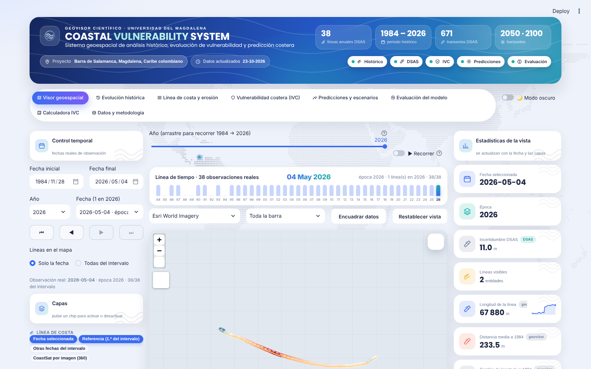
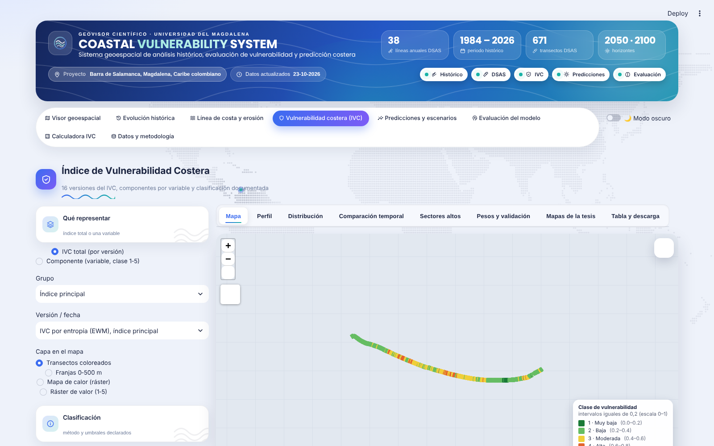
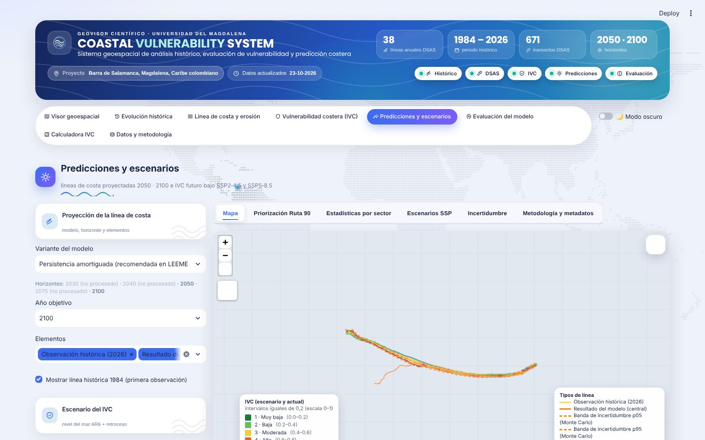
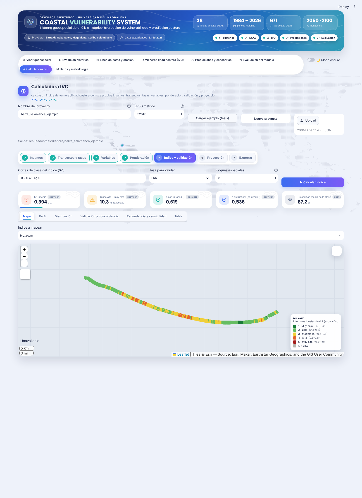
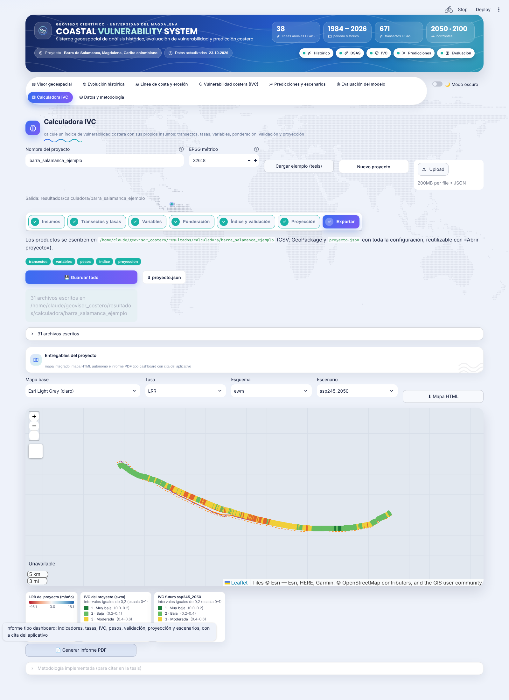

# Coastal Vulnerability System — geovisor costero

**Sistema geoespacial de análisis histórico, evaluación de vulnerabilidad y predicción costera.** Proyecto: Barra de Salamanca (Magdalena, Caribe colombiano). Tesis de Maestría en Ingeniería, Universidad del Magdalena — Vanessa Yance.

Geovisor científico (Streamlit + Folium/Leaflet + Plotly + GeoPandas) que lee **los resultados reales** de la tesis (CoastSat, DSAS v6.1, IVC‑EWM/FAHP, modelos y proyecciones 2050/2100) sin modificarlos, e incluye una **Calculadora IVC** genérica —auditada y verificada frente a DSAS y a la tesis— que reproduce todo el flujo (transectos y tasas → variables → ponderación → índice y validación → proyección) con datos propios o de otra zona de estudio, y entrega mapas, capas, un informe PDF tipo dashboard y un mapa HTML autónomo.



| | |
|---|---|
|  |  |
|  |  |

**Documentación:** [Guía de usuario (PDF)](docs/GUIA_USUARIO.pdf) · [Guía (Markdown)](docs/GUIA_USUARIO.md) · [Inventario de archivos](docs/INVENTARIO.md) · [Auditoría del motor de cálculo](docs/AUDITORIA_CALCULADORA.md) · [Corrida de verificación](resultados/pruebas_calculadora/00_LEEME.md) · [Informe PDF de ejemplo](resultados/pruebas_calculadora/informe_dashboard_barra_salamanca.pdf)

**Inicio rápido**

```bash
conda create -n coastsat python=3.11 && conda activate coastsat   # o su entorno existente
pip install -r requirements.txt
cp config.local.ejemplo.yaml config.local.yaml   # edite las rutas a sus datos (o use solo la Calculadora con sus propios archivos)
streamlit run app.py
```

Los datos de la tesis (CoastSat, DSAS, IVC, modelos) **no están en el repositorio** (son ~GB y pertenecen a la tesis); sin ellos la aplicación arranca igualmente y la Calculadora IVC funciona con cualquier conjunto de líneas de costa y variables. Pruebas: `python -m pytest tests` (51 pruebas; las que dependen de los datos de la tesis se omiten si no están).

Versión 1.0 (26‑10‑2026).

## 1. Qué hace

| Sección | Contenido | Fuente de datos |
|---|---|---|
| Visor geoespacial | Mapa central (zoom, desplazamiento, 4 mapas base, coordenadas del cursor, escala, medición), 18 capas conmutables, control temporal con las 360 fechas reales (1984‑09‑02 → 2026‑09‑06), panel de estadísticas, consulta de atributos, descarga | `exportar_coastsat/postproceso`, `dsas`, `ivc`, `QGIS_IVC`, `Modelos/07_Proyecciones` |
| Evolución histórica | Modo A comparación de dos fechas · Modo B acumulación cronológica con leyenda por año · Modo C animación con fechas reales (TimestampedGeoJson) · gráficos de longitud y observaciones por año · enlaza animaciones ya generadas en `video_evolucion_costa` | `lineas_fechas_completas.shp`, `cobertura_por_anio.csv` |
| Línea de costa y erosión | EPR, LRR, WLR, NSM, SCE **importados de DSAS v6.1** (671 transectos, IC95), perfil a lo largo de la costa, histogramas, sectores críticos, informe oficial, contraste con las tasas del script de postproceso, descarga | `dsas/dsas_tasas.shp`, `DSAS_summary_report_*.txt`, `tasas_transectos_100m_marea_corregida.geojson` |
| Índice de Vulnerabilidad Costera | 16 versiones (EWM total/estructural, TOPSIS‑EWM, pesos iguales, CVI de Gornitz, 2005/2026, modelos, SSP) como transectos, franjas 0‑500 m, mapa de calor o ráster de valor; componentes (15 variables, clase 1‑5); histograma, estadísticas, comparación temporal, sectores altos, pesos EWM y validación contra DSAS | `QGIS_IVC/datos/IVC_Barra_Salamanca.gpkg`, `QGIS_IVC/rasters/*.tif`, `ivc/tabla_clases_1_5_ivc.csv`, `Mapas_IVC/*.csv` |
| Predicciones y escenarios | Líneas 2050 y 2100 (central, p05/p95 Monte Carlo, persistencia) en 3 variantes; IVC SSP2‑4.5/SSP5‑8.5 2050/2100 con banda inf–sup; estadísticas por sector; metadatos del modelo. 2030/2040/2075 se muestran como **no procesados** | `Modelos/07_Proyecciones/*`, `Mapas_IVC/escenarios_v4_resumen.csv` |
| Evaluación del modelo | Métricas v4 de la validación anidada (R²_OS con IC95, RMSE, MAE, ρ, coincidencia de clase), comparación pareada, MSE por bloque, cobertura conformal, validación CoastSat vs. línea manual, importación de tablas externas | `Modelos/06_Validacion_anidada/resultados/*.csv` |
| Datos y metodología | Catálogo de archivos (CRS, extensión, campos, fechas), procedencia de cada capa, flujo metodológico, entorno, instrucciones de publicación | `resultados/catalogo/catalogo_datos.*` |

Reglas de honestidad científica implementadas: nada se interpola ni se simula; cada indicador lleva su procedencia
(`DSAS`, `script`, `geovisor`, `modelo`, `importado`); los datos ausentes se muestran como «No disponible», nunca como 0;
los umbrales de clase del IVC están declarados en `config.yaml` y se verificó que reproducen las clases de los archivos.

### Fuente de las líneas de costa del control temporal

Desde la versión del 20‑10‑2026 el control temporal (visor y evolución histórica) usa como capa principal
`exportar_coastsat/dsas/lineas_anuales_dsas.shp` (38 líneas anuales × 2 lados, campos `ID, epoca, lado, DATE_, UNCY`,
EPSG:32618; 1984‑11‑28 → 2026‑05‑04), es decir, exactamente el insumo con el que se corrió DSAS. La fecha mostrada es el
campo `DATE_`; la longitud se recalcula en EPSG:32618 (procedencia «geovisor») porque el archivo no la trae, y la
cobertura no se inventa (el archivo no tiene ese campo). Las 360 líneas CoastSat por fecha de imagen siguen disponibles
como capa opcional «Líneas CoastSat por fecha de imagen» dentro del intervalo. La capa se cambia en
`config.yaml → temporal.capa_lineas` (`lineas_anuales_dsas` o `lineas_fecha`).

### Actualización 23‑10‑2026: productos v4 recientes, capas compactas y Ruta 90

- **IVC 2005 reconstruido** (productos regenerados el 23‑10‑2026 a las 22:08–23:17: `IVC_Barra_Salamanca.gpkg`, rásteres,
  `ivc_versiones_transectos.*`, `concordancia_versiones.csv`, mapas y Atlas): la versión `ewm_2005` ya es la reconstruida con la
  línea DSAS de 2005 (650 transectos, IVC medio 0,372 frente a 0,400 en 2026; clase alta 37 frente a 69; coincidencia 81 %).
  El geovisor la lee directamente del GeoPackage. Además: en *Componente (variable)* se puede elegir el estado de las clases
  **2026 / 2005 (reconstruido)** (`Mapas_IVC/clases_2005_reconstruidas.csv`), y en *Comparación temporal* hay un bloque
  2005 ↔ 2026 con KPIs y el % de transectos cuya clase cambia por variable (cálculo del geovisor sobre los dos CSV).

- **Mapa sin recargas en el visor**: el mapa base se crea una sola vez por sesión y las capas dinámicas (líneas, DSAS, IVC,
  predicciones, Ruta 90…) se pasan como `FeatureGroup` a `st_folium(feature_group_to_add=…)`, que solo sustituye esas capas.
  Resultado: al cambiar de fecha o reproducir la línea de tiempo no hay pantalla en blanco ni saltos de zoom, y el encuadre del
  usuario se conserva. Las leyendas se dibujan como tarjetas bajo el mapa (no pueden actualizarse dentro del iframe).

- **Priorización de la Ruta 90** (Predicciones → pestaña *Priorización Ruta 90*, y capa «Ruta 90 priorizada» en el visor):
  mapa de la vía coloreada por prioridad (Alta < 2050 · Media 2050–2100 · Baja), KPIs, gráfico del año de alcance por tramo
  con su intervalo y tabla descargable. Fuente: `Multicriterio/priorizacion_ruta90_v4.csv` (fig_escenarios_v4.py, 17‑10‑2026).
  El geovisor **no recalcula** los años: solo reproduce el trazado de la Figura 37 (segmentos de ~50 m de la vía con la prioridad
  del tramo de costa más cercano, a ≤ 1,3 km). Módulo `src/ruta90.py`.
- **Mapas de la tesis** (IVC → pestaña *Mapas de la tesis*): galería de `Mapas_IVC/mapas_individuales/Mapa_01…18.png`,
  figuras de síntesis 26–30 y descarga del Atlas PDF; el mapa de la versión activa se propone por defecto.
- **Normalización M1 frente a M2** (IVC → *Pesos y validación*): pesos EWM con IC95 y validación (`comparacion_M1_M2_*.csv`, 18‑10‑2026).
- **Tablas de la tesis** (Evaluación → *Tablas de la tesis e histórico*): descarga de `Tablas_10_…_v4_R2OS.xlsx` (20‑10‑2026,
  «habilidad» renombrada a R²_OS) y `Tablas_09_TOPSIS.xlsx`.
- **Listado de capas compacto**: chips (`st.pills`) agrupados por tema (Línea de costa · DSAS · IVC · Predicciones · Contexto · Imágenes);
  las capas sin datos no se ofrecen y se listan al pie.
- Nuevas claves del catálogo: `ruta90_priorizacion`, `ruta90_priorizacion_v3`, `figura_ruta90`, `mapas_individuales_dir`,
  `figuras_ivc_dir`, `atlas_ivc_pdf`, `comparacion_m1_m2_pesos`, `comparacion_m1_m2_validacion`, `tablas_10_r2os`, `tablas_09_topsis`.

## 1b. Diseño de la interfaz

Inspirado en paneles modernos de observación terrestre y analítica (tarjetas redondeadas, cristal, píldoras, cifras grandes):

* **Dos temas conmutables** (interruptor «Modo oscuro» junto a la navegación): claro azul‑grisáceo y oscuro azul marino. Todo el sistema usa variables CSS (`src/estilos.py`, `TEMAS`), y los gráficos Plotly se adaptan (`graficos.aplicar_tema`).
* **Cabecera hero** con degradado, brillo animado, cifras grandes (fechas, periodo, transectos, horizontes) y píldoras de estado de módulos.
* **Navegación en píldoras** con iconos Material; pestañas internas en píldoras.
* **Barra de tiempo 1984 → 2026** sobre el mapa (sección Visor): control deslizante por año que salta a la observación real más cercana, botón «▶ Recorrer» (una observación por segundo), y mini‑histograma de imágenes por año con el año activo resaltado; sincronizada con los selectores de año/fecha y los botones ⏮ ◀ ▶ ⏭.
* **Fondo con mapa general**: `scripts/generar_fondo.py` crea `assets/fondo_mapa_claro.png` y `_oscuro.png` (transparentes) con el mapamundi en puntos hexagonales (tierra Natural Earth 1:110m, dominio público, `assets/tierra_mundo_110m.geojson`), el Caribe colombiano resaltado y un marcador en la Barra de Salamanca; la app los genera sola la primera vez y los coloca detrás de las tarjetas. Motivos de olas: logotipo, olas animadas en la cabecera, subrayado ondulado en los títulos y marca de agua en paneles y KPIs.
* **Tipografía Poppins** (Google Fonts; sin internet se usa la fuente del sistema).
* **KPIs** con icono por tipo, *sparkline* animado y barra de progreso; **anillos** con valor central; **radar** de las 15 variables del IVC (todos los transectos vs. clase alta/muy alta); **animación anual ▶ / ⏸** en Evolución histórica; barras redondeadas y transiciones.

## 2. Requisitos

* Windows 10/11 (probado también en Linux), Python ≥ 3.10 — se recomienda el entorno conda `coastsat` ya existente.
* Paquetes: ver `requirements.txt`. Comprobar primero qué falta:

```bat
conda activate coastsat
cd "D:\TRABAJO DE INVESTIGACION\Resultados tesis\geovisor_costero"
python scripts/comprobar_entorno.py
pip install streamlit streamlit-folium folium plotly pyyaml      # solo los que marque como FALTA
```

> No actualice geopandas/shapely/pyproj/rasterio del entorno de CoastSat si ya están; el geovisor funciona con
> geopandas ≥ 0.14 y rasterio ≥ 1.3. Si `pyogrio` falta, instálelo (`pip install pyogrio`) o cambie `engine="pyogrio"` por `fiona` en `src/vectores.py`.

## 3. Ejecución local

```bat
conda activate coastsat
cd "D:\TRABAJO DE INVESTIGACION\Resultados tesis\geovisor_costero"
streamlit run app.py
```

o doble clic en `abrir_geovisor.bat`. Se abre en `http://localhost:8501`.

Primer uso: en **Datos y metodología → Catálogo de archivos** pulse *Generar / actualizar catálogo* para inventariar
`exportar_coastsat`, `Resultados tesis` y las escenas Landsat de `data/` (solo lee cabeceras; no copia nada).
El catálogo activa el selector de escenas Landsat del visor.

Pruebas: `python -m pytest -q tests` (31 pruebas; las que dependen de datos se omiten si faltan los archivos).

## 4. Configuración (`config.yaml`)

* `rutas`: carpetas originales de CoastSat y de la tesis (no se copian datos). Para otro equipo cree `config.local.yaml`
  con solo las claves que cambian (se superpone a `config.yaml`; está en `.gitignore`).
* `crs`: métrico `EPSG:32618` (longitudes, áreas, simplificación) y visualización `EPSG:4326` (Leaflet).
* `mapa`: encuadre inicial, mapas base, coordenadas del cursor, escala.
* `visualizacion`: colores, grosores, opacidades, tolerancia de simplificación **solo para dibujar**, tamaño máximo de ráster en pantalla.
* `temporal`: fechas inicial/final (null = primera y última reales), formato del campo `fecha`.
* `ivc`: método y cortes de clasificación (intervalos iguales de 0,2 en 0‑1 = 1,8/2,6/3,4/4,2 en 1‑5), colores de clase, versión principal.
* `predicciones`: horizontes previstos (solo se muestran los procesados) y variante por defecto.
* `cache`, `modulos`, `exportacion`.

## 5. Estructura

```
geovisor_costero/
  app.py                      interfaz (cabecera, navegación, manejo de errores por sección)
  config.yaml                 configuración
  scripts/comprobar_entorno.py        diagnóstico de dependencias y rutas
  scripts/preparar_publicacion.py     copia ligera de datos para la versión web
  scripts/generar_pruebas_calculadora.py  corrida de verificación de la Calculadora (resultados/pruebas_calculadora)
  scripts/capturas_calculadora.py     capturas de la Calculadora paso a paso
  docs/                       guía de usuario, inventario y auditoría
  abrir_geovisor.bat          lanzador Windows
  src/
    configuracion.py  inventario.py  catalogo_datos.py  cachear.py  contexto.py
    vectores.py  rasteres.py  temporal.py  dsas.py  ivc.py  predicciones.py
    metricas_modelos.py  mapas.py  graficos.py  exportaciones.py  estilos.py
    paginas/ visor.py evolucion.py erosion.py ivc.py predicciones.py evaluacion.py datos.py comunes.py
  resultados/ catalogo/ cache/ exportaciones/ reportes/
  tests/ test_inventario.py test_geometrias.py test_temporal.py test_modulos.py
  logs/
```

Arquitectura de datos: `catalogo_datos.py` declara cada capa (raíz + ruta relativa + formato + capa interna + procedencia);
`vectores.py`/`rasteres.py` son los adaptadores por formato con caché (`st.cache_data`, firma por mtime) y lectura selectiva;
los rásteres se decimen a ≤ 1400 px y se reproyectan a 4326 solo para dibujar (PNG cacheado en `resultados/cache`).

## 6. Exportaciones

GeoJSON (siempre EPSG:4326, por especificación), GeoPackage (CRS original EPSG:32618), CSV de atributos (+WKT) y PNG estático.
Se escriben en `resultados/exportaciones/` con sello de tiempo; los originales nunca se sobrescriben.

## Calculadora IVC (motor de cálculo genérico, 24‑10‑2026)

Nueva sección **Calculadora IVC** (`src/paginas/calculadora.py`, motor en `src/calculo/`): calcula un índice de vulnerabilidad
costera con insumos propios, para cualquier costa, reproduciendo el método de la tesis. Asistente de 7 pasos:

| Paso | Qué hace | Módulo | Verificación con la Barra de Salamanca |
|---|---|---|---|
| 1 Insumos | Líneas de costa multifecha (campo de fecha, incertidumbre), línea base (archivo o generada) y transectos (generados o importados), fecha de referencia P0 | `proyecto.py` | — |
| 2 Transectos y tasas | Transectos perpendiculares a la base suavizada; intersección con cada línea; NSM, SCE, EPR (± EPRUNC), LRR (R², LSE, LCI95) y WLR (1/σ²) | `transectos.py`, `tasas.py` | Con los transectos y líneas DSAS reproduce las 671 tasas (error < 0,001 m/año); los transectos generados desde la línea base DSAS coinciden (azimut mediano 0,05°) |
| 3 Variables | Franjas d0–d1 m desde P0 (ancho = espaciado): estadísticos de ráster, pendiente, % de área por categoría, media por área, distancia a entidades, valor más cercano, ancho de barra, tabla por id, tasa del paso 2 o constante. Normalización M1 (umbrales), categorías→clase, % de área × puntaje, directa, difusa 0‑1 o quintiles | `muestreo.py`, `normalizacion.py` | Las 15 clases de `tabla_clases_1_5_ivc.csv` se reproducen exactamente |
| 4 Ponderación | EWM con IC95 (bootstrap de bloques), FAHP (Buckley o Chang, TFN, CR de Saaty) desde la matriz por pares, pesos iguales, manuales y combinación FAHP‑EWM (multiplicativa o lineal) | `ponderacion.py` | Pesos EWM = `pesos_ewm_ivc.csv` (error < 1e‑9) |
| 5 Índice y validación | IVC = (Σ w c − 1)/4, TOPSIS, CVI de Gornitz; ρ de Spearman vs −tasa con IC95 por bloques (y versión estructural no circular), κ entre esquemas, VIF, sensibilidad de pesos, estabilidad de clase | `indice.py` | IVC‑EWM y TOPSIS idénticos a la tesis; ρ = 0,619 / 0,536 |
| 6 Proyección | Ventanas de L años; transición Δ por persistencia, persistencia amortiguada, ridge o RF con validación en bloques + zona de exclusión (R²_OS); Monte Carlo; líneas central/p05/p95/persistencia; Bruun opcional; IVC futuro por escenario con roles dinámicos | `proyeccion.py` | R²_OS = +10,0 % (IC95 1–24 %, 7/8 bloques) y desplazamientos 2100 con r = 0,99999 frente a `resultados_amortiguada`; % clase alta 2050 = 12,97 (tesis 12,97) |
| 7 Exportar | CSV, GeoPackage y `proyecto.json` en `resultados/calculadora/<nombre>/`; el JSON se reabre con «Abrir proyecto» | `proyecto.exportar_todo` | — |

**Interfaz (24‑10, tarde):** los pasos se muestran como un recorrido numerado (✓ en los completos); cada variable es una tarjeta
desplegable con tres bloques —*qué tipo de dato es y dónde está* (desplegable de tipo, subida del archivo ya recortado al área de
estudio o ruta local, capa/campo detectados automáticamente, franja), *cómo se convierte en clase* (método de clasificación con
sus parámetros: cuatro cortes y sentido, clase por categoría leída del propio archivo, % de área, difusa, quintiles) y *papel en la
proyección*—. Una lista de plantillas (elevación, geomorfología, oleaje, d50, usos, distancia a infraestructura, ancho de barra…)
añade variables con los umbrales de la tesis ya puestos. Los archivos subidos se guardan en `resultados/calculadora/<proyecto>/insumos/`.

El botón **Cargar ejemplo Barra de Salamanca** rellena el proyecto con los insumos de la tesis (`src/calculo/ejemplos.py`); las
variables cuya fuente original no está exportada se importan por transecto desde `tabla_variables_ivc_transectos.csv`.
Lo que **no** hace la calculadora: entrenar el CNN‑LSTM ni el apilamiento (se hacen fuera y pueden importarse como variable o
tabla). Pruebas: `tests/test_calculadora.py`. Requiere `scikit-learn` (añadido a `requirements.txt`).

## Auditoría, verificación y documentación (25‑10‑2026)

* **Auditoría independiente del motor de cálculo** (`docs/AUDITORIA_CALCULADORA.md`): 60 comprobaciones frente a DSAS v6.1, implementaciones de referencia y casos sintéticos. Se corrigieron 10 defectos (TOPSIS con NaN, tasa media para horizontes cercanos, cortes de clase en sensibilidad/estabilidad, incertidumbre 0, polígonos solapados, ids repetidos, EWM con columnas constantes, validación de la matriz de Saaty, invalidación de resultados al cambiar parámetros) y se añadieron TOPSIS relativo, ρ por bloque, IC iid de EWM, sensibilidad por exclusión y exportaciones ampliadas. Pruebas de regresión en `tests/test_auditoria.py` (suite: 50 pruebas).
* **Corrida de verificación** (`scripts/generar_pruebas_calculadora.py` → `resultados/pruebas_calculadora/`): tablas, GeoPackages, gráficos, mapas y capturas de cada paso, con `00_LEEME.md` (25/25 comprobaciones frente a la tesis).
* **Guía de usuario** `docs/GUIA_USUARIO.md` e **inventario** `docs/INVENTARIO.md` (dónde está cada cosa).
* **Organización**: utilidades en `scripts/` (`comprobar_entorno.py`, `generar_fondo.py`, `preparar_publicacion.py`, `generar_pruebas_calculadora.py`, `capturas_calculadora.py`); documentación en `docs/`.

## Interfaz (25‑10‑2026)

- **Tipografía**: Manrope (Google Fonts) en toda la interfaz — botones, chips de capas, pestañas, tablas, entradas, notas y mapa —; Poppins solo en los textos principales (cabecera, títulos de sección, cifras de las tarjetas). Si el equipo no tiene acceso a Google Fonts, el navegador usa Segoe UI / la fuente del sistema.
- **Botones y campos alineados**: todos los botones ocupan el ancho de su columna con 42 px de alto; selectores y campos de texto tienen la misma altura, de modo que las filas quedan alineadas.
- **Cabecera** sin animación de reflejo; las cuatro cifras del encabezado tienen el mismo tamaño.
- **Pestañas horizontales**: barra segmentada (fondo gris, pestaña activa blanca con sombra y subrayado azul‑teal); el asistente de la Calculadora conserva su numeración con ✓.
- **Tablas**: borde, cabecera gris con mayúsculas pequeñas y números tabulares (opciones `dataframe*` del tema en `.streamlit/config.toml`).
- **Tablas HTML propias** (`ui.tabla`, sustituye a `st.dataframe` en todas las páginas): cabecera fija, filas alternas, números alineados a la derecha, modo oscuro; booleanos como ✓/✕ y vacíos como «—».
- **Notas explicativas plegadas**: cada nota se muestra como un pequeño «ⓘ» y el texto aparece al pulsarlo; la interfaz queda con menos texto.
- **Título genérico** «Coastal Vulnerability System»; el área de estudio aparece debajo como chip «Proyecto · Barra de Salamanca…» (editable en `config.yaml › app.area_estudio`).
- **Indicadores sin dato se ocultan** (ya no se muestra «No disponible»); al abrir el geovisor están activas las capas *Transectos* y *Tasas LRR*, así el resumen de la vista muestra desde el inicio el número de transectos y la tasa media.

## Publicación

### Qué puede publicarse y qué no

| Tipo | Tamaño | Destino recomendado |
|---|---|---|
| Código de la aplicación | < 1 MB | repositorio GitHub (público o privado) |
| Capas derivadas ligeras (líneas por fecha 18,7 MB, líneas anuales, DSAS, IVC gpkg 1,6 MB, rásteres del IVC ≈ 5 MB, proyecciones, métricas) | **≈ 64 MB en total** (`python scripts/preparar_publicacion.py`) | dentro del repositorio (GitHub admite archivos < 100 MB) |
| Escenas Landsat de CoastSat (`data/`, decenas de GB), `vista_*.geojson` (hasta 420 MB), `.pkl` | muy grandes | **no publicar**; permanecen en el equipo o en Zenodo/Drive y la versión web no los necesita |
| Modelos entrenados (`.joblib`, `.keras`) | 0,2–9 MB | no hacen falta: la web muestra resultados ya calculados, nunca ejecuta los modelos |

La versión pública solo carga capas optimizadas y resultados derivados; ningún modelo pesado se ejecuta al abrir el mapa.

### Opción recomendada: Streamlit Community Cloud (gratuita, se actualiza sola con cada `git push`)

1. `python scripts/preparar_publicacion.py` → crea `datos_publicacion/` (≈ 64 MB) y `config.publico.yaml`.
2. Renombre `config.publico.yaml` a `config.local.yaml` **dentro del repositorio público** con rutas relativas
   (`datos_publicacion/exportar_coastsat`, …) y quite ambas entradas de `.gitignore` para ese repositorio.
3. Cree un repositorio en GitHub y suba: código, `requirements.txt`, `.streamlit/config.toml`, `datos_publicacion/`.
   Añada `packages.txt` con `libgdal-dev` solo si la instalación de rasterio/pyogrio fallara (normalmente las ruedas binarias bastan).
4. En https://share.streamlit.io → *New app* → elija el repositorio, rama y `app.py`.
5. Cada `git push` redespliega la app automáticamente. Límites publicados: 0,078–2 núcleos, 690 MB–2,7 GB de RAM,
   hasta 50 GB de almacenamiento; la app «duerme» tras 12 h sin visitas y cualquier visitante la despierta.
   Apps públicas ilimitadas y una privada por cuenta.

Para actualizar los datos: vuelva a ejecutar `scripts/preparar_publicacion.py` en su equipo y haga `git commit` + `git push`.

### Alternativas gratuitas (si cambian las condiciones)

* **Hugging Face Spaces** (Docker): 2 vCPU y 16 GB de RAM en CPU Basic, Git con LFS para archivos grandes; duerme tras 48 h.
  Según fuentes de 2026 los Spaces Gradio/Docker pueden requerir plan PRO (9 USD/mes); verifique antes de elegirlo.
* **Render** (web service gratuito): 512 MB de RAM, 0,1 CPU, se apaga tras 15 min sin tráfico (≈ 1 min para despertar),
  5 GB/mes de ancho de banda; con un `Dockerfile` o `pip install -r requirements.txt` + `streamlit run app.py --server.port $PORT`.
* **Railway** (plan Free): 0,5 GB por servicio y 1 USD/mes de crédito; requiere vigilar el consumo.
* **Fly.io** y **Koyeb** ya no ofrecen nivel gratuito sin tarjeta (2026).
* **Datos científicos grandes**: Zenodo (DOI, hasta 50 GB por registro, versionado) para rásteres y escenas; la app puede
  descargarlos bajo demanda por URL si en el futuro se quisieran mostrar.

Fuentes: documentación de Streamlit Community Cloud (https://docs.streamlit.io/deploy/streamlit-community-cloud/manage-your-app)
y comparativa de alojamiento gratuito con fecha 28‑09‑2026 (https://snapdeploy.dev/state-of-free-hosting).

### Seguridad

* La interfaz no muestra rutas del equipo (alias `[CoastSat]`, `[Resultados tesis]`).
* No se configuran túneles ni puertos públicos; `server.headless = true` en `.streamlit/config.toml` solo evita abrir el navegador.
* Si publica una app privada, use `st.secrets` para cualquier credencial futura; hoy no se necesita ninguna.

## 7. Limitaciones conocidas de esta versión

* El encuadre del mapa se fija a la extensión de los datos (botones *Encuadrar datos* / *Restablecer vista*); al cambiar
  de fecha el mapa se vuelve a dibujar con ese encuadre (no conserva el zoom manual).
* Las escenas Landsat se muestran en color natural con estiramiento P2–P98; la escena propuesta es la más cercana a la
  fecha seleccionada y se avisa si no coincide exactamente.
* El GeoPackage del proyecto DSAS (`Cambio de linea de costa DSAS.gpkg`) es un contenedor SpatiaLite que GDAL no interpreta;
  se usan los Shapefiles exportados por DSAS.
* FAHP (panel de expertos) aún no tiene resultados; el IVC mostrado es el esquema por entropía (EWM) de la tesis.

## Cómo citar

Yance, V. (2026). *Coastal Vulnerability System: geovisor y calculadora del Índice de Vulnerabilidad Costera — Barra de Salamanca* (versión 1.0) [Software]. Universidad del Magdalena. https://github.com/vanessayanceao-svg/geovisor_costero

Véase `CITATION.cff` (GitHub muestra el botón «Cite this repository»). Licencia MIT (`LICENSE`).

## Publicar en GitHub (primera vez)

```bash
cd geovisor_costero
git init
git add .
git commit -m "Coastal Vulnerability System v1.0: geovisor, calculadora IVC auditada, documentación"
git branch -M main
git remote add origin https://github.com/vanessayanceao-svg/geovisor_costero.git
git push -u origin main
```

`.gitignore` excluye `config.local.yaml` (rutas del equipo), `resultados/calculadora/` (proyectos propios), cachés y logs. Sí se versionan `docs/` (guía, auditoría, capturas) y `resultados/pruebas_calculadora/` (corrida de verificación, ≈ 13 MB), para que los evaluadores puedan revisar los productos sin ejecutar nada.
