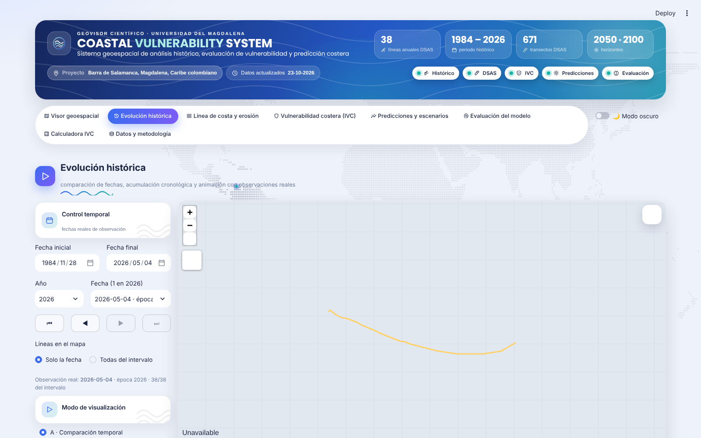
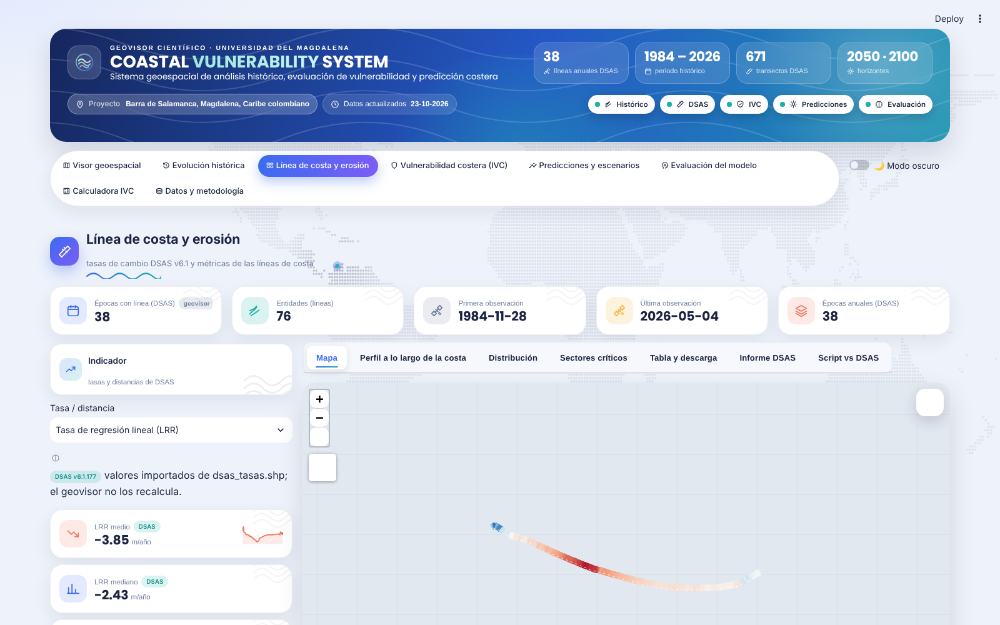
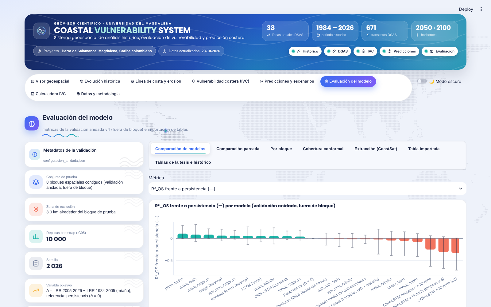
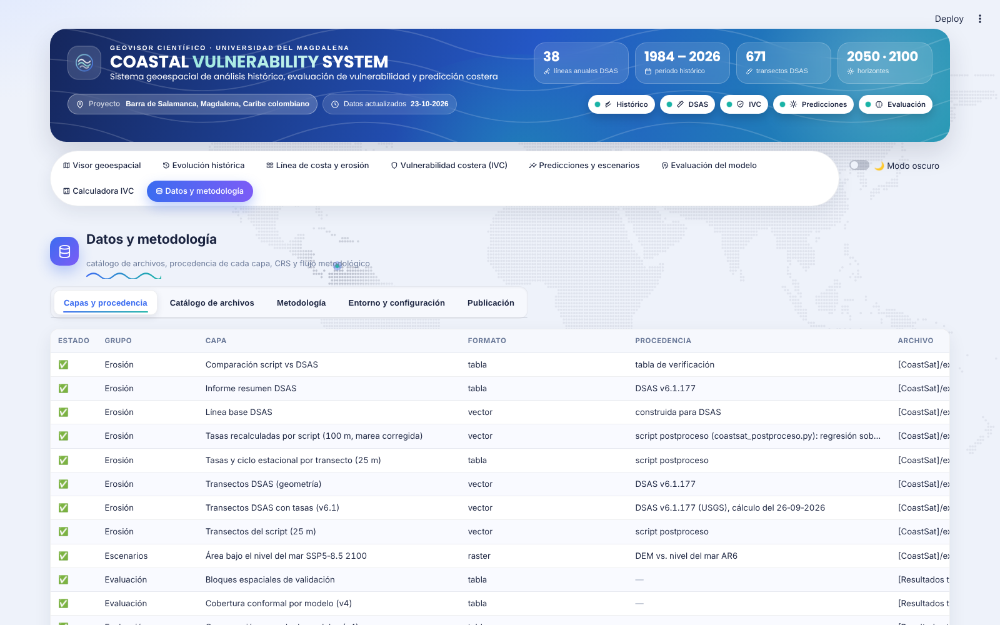

# Guía de usuario — Coastal Vulnerability System (geovisor costero)

Versión del 26‑10‑2026 · Proyecto: Barra de Salamanca, Magdalena, Caribe colombiano · Universidad del Magdalena, Maestría en Ingeniería.

El geovisor es una aplicación de escritorio (navegador local, sin servidor público) que reúne en un solo lugar los productos de la tesis —líneas de costa CoastSat 1984‑2026, tasas DSAS, Índice de Vulnerabilidad Costera (IVC), proyecciones 2050/2100 y evaluación de modelos— y una **Calculadora IVC** genérica que reproduce todo el flujo de cálculo con los insumos de la tesis o con datos de otra zona de estudio.

---

## 1. Instalación y arranque

**Requisitos.** Windows con Anaconda/Miniconda y el entorno `coastsat` (Python ≥ 3.10) con los paquetes de `requirements.txt` (`streamlit`, `streamlit-folium`, `geopandas`, `rasterio`, `plotly`, `scikit-learn`, …). Para instalar lo que falte, en Anaconda Prompt:

```bat
conda activate coastsat
pip install -r requirements.txt
```

**Arranque.** Doble clic en `abrir_geovisor.bat` (activa el entorno, comprueba dependencias y rutas, y abre http://localhost:8501), o manualmente:

```bat
cd /d "D:\TRABAJO DE INVESTIGACION\Resultados tesis\geovisor_costero"
conda activate coastsat
streamlit run app.py
```

Para detenerlo cierre la ventana de comandos (o Ctrl+C). Si cambia archivos de datos, pulse **R** en la aplicación o recargue con Ctrl+F5.

**Diagnóstico.** `python scripts/comprobar_entorno.py` lista las dependencias instaladas y los módulos disponibles según las rutas de `config.yaml`.

**Rutas de datos.** `config.yaml › rutas` apunta a las carpetas originales de CoastSat (`exportar_coastsat`) y de la tesis (`Resultados tesis`). El geovisor **solo lee** esos archivos; nunca los modifica. En otro equipo cree `config.local.yaml` con las rutas propias (tiene prioridad sobre `config.yaml`).

---

## 2. Estructura de la pantalla


* **Cabecera**: nombre del sistema, cifras clave (líneas anuales, periodo, transectos, horizontes), chip **Proyecto** con el área de estudio, fecha de actualización de los datos y estado de cada módulo (punto verde = disponible).
* **Menú de secciones** (pestañas): Visor geoespacial · Evolución histórica · Línea de costa y erosión · Vulnerabilidad costera (IVC) · Predicciones y escenarios · Evaluación del modelo · Calculadora IVC · Datos y metodología. A la derecha, el interruptor **Modo oscuro**.
* Dentro de cada sección: panel de controles a la izquierda, mapa o gráfico en el centro, indicadores (tarjetas) a la derecha, y pestañas horizontales para los distintos análisis.
* Las notas explicativas están plegadas tras el icono **ⓘ**; pulse para leerlas. Los iconos **?** junto a los controles muestran ayuda al pasar el cursor.
* Los indicadores sin dato para la vista actual se ocultan (nunca se muestra un cero en lugar de un dato ausente).
* Todas las tablas pueden descargarse (botones **CSV / GeoJSON / GPKG** bajo cada tabla o mapa, según el caso).

---

## 3. Secciones

### 3.1 Visor geoespacial

Mapa interactivo con control temporal.

* **Control temporal**: fecha inicial/final del intervalo, año y fecha (una de las 38 líneas anuales DSAS). Botones ⏮ ◀ ▶ ⏭ para moverse entre observaciones; **▶ Recorrer** reproduce las fechas automáticamente (el encuadre y el zoom se conservan).
* **Líneas en el mapa**: solo la fecha seleccionada, o todas las del intervalo (rampa cronológica).
* **Capas** (chips por grupo): Línea de costa (fecha seleccionada, referencia 1984, otras fechas, CoastSat por imagen), DSAS (transectos, tasas LRR, línea base), IVC (mapa de calor, franjas), Predicciones (líneas 2050/2100, IVC futuro SSP, Ruta 90 priorizada), Contexto (sectores, Boca de la Ciénaga, Ruta 90, edificaciones, geomorfología, manglar) e Imágenes (fondo tierra/agua, escena Landsat). Al abrir la aplicación están activas la fecha seleccionada, la referencia, los transectos y las tasas LRR.
* **Opciones de capas**: campo de tasa (LRR, EPR, WLR…), versión del IVC, variante y año de la proyección, escenario SSP, sector y fecha de la escena Landsat.
* **Mapa base** (Esri World Imagery, OpenStreetMap, Esri Light/Dark Gray, Esri Topo), **Acercar a** un sector, **Encuadrar datos** y **Restablecer vista**.
* **Estadísticas de la vista**: fecha, época, incertidumbre DSAS, líneas visibles, longitud de la línea, distancia media a la referencia, transectos, tasa media, IVC medio (al activar una capa del IVC), año/escenario de predicción.
* Las leyendas aparecen bajo el mapa. El control de capas de Leaflet (arriba a la derecha) permite ocultar capas sin recargar.

### 3.2 Evolución histórica



Tres modos: **A · Comparación temporal** (dos fechas superpuestas), **B · Acumulación histórica** (todas las líneas del intervalo con rampa de color) y **C · Animación** (un fotograma por año real, duración ajustable). Pestañas: animación anual, longitud de la línea por fecha y número de observaciones por año. Permite exportar el GIF/MP4 si está generado.

### 3.3 Línea de costa y erosión



Tasas DSAS v6.1 por transecto (671 transectos cada 100 m). **Tasa / distancia**: LRR, WLR, EPR, NSM, SCE y sus incertidumbres. Pestañas: **Mapa** (transectos coloreados), **Perfil a lo largo de la costa** (con banda IC95), **Distribución** (histograma con umbrales de clase), **Sectores críticos** (N transectos más erosivos), **Tabla y descarga**, **Informe DSAS** y **Script vs DSAS** (verificación del postproceso frente a DSAS).

Signo: valores negativos = retroceso (erosión, hacia tierra); positivos = avance.

### 3.4 Vulnerabilidad costera (IVC)


* **Tipo**: IVC total (por versión/fecha: 2026, 2005 reconstruido, control) o una componente (variable en clase 1‑5, estado 2026 o 2005).
* **Capa en el mapa**: transectos coloreados, franjas 0‑500 m o mapa de calor (ráster).
* Pestañas: **Mapa**, **Perfil** (IVC por km con banda inf–sup), **Distribución** (transectos por clase), **Comparación temporal** (2005 ↔ 2026: cambio de clase por variable), **Sectores altos**, **Pesos y validación** (pesos EWM con IC95, M1/M2, ρ de Spearman con la tasa, κ), **Mapas de la tesis** (figuras y atlas) y **Tabla y descarga**.

Clases del IVC (escala 0‑1, intervalos iguales de 0,2): 1 muy baja · 2 baja · 3 moderada · 4 alta · 5 muy alta.

### 3.5 Predicciones y escenarios


* **Variante del modelo** (persistencia amortiguada v4 y otras), **año objetivo** (2050, 2100), **escenario SSP y año** para el IVC futuro.
* Pestañas: **Mapa** (línea 2026 en amarillo, modelo en naranja, banda p05–p95 discontinua, escenario de referencia en violeta), **Priorización Ruta 90** (tramos de la vía por prioridad y año estimado en que la costa la alcanza), **Estadísticas por sector**, **Escenarios SSP** (% de transectos en clase alta/muy alta por escenario), **Incertidumbre** (Monte Carlo, Bruun) y **Metodología y metadatos**.

### 3.6 Evaluación del modelo



Métricas de la validación anidada v4 (fuera de bloque): **Comparación de modelos** (R²_OS frente a persistencia, MAE, RMSE, con IC95), **Comparación pareada**, **Por bloque**, **Cobertura conformal**, **Extracción (CoastSat)** (desplazamiento frente a línea manual), **Tabla importada** (para comparar métricas propias) y **Tablas de la tesis e histórico** (Tablas 09/10 y versiones anteriores).

### 3.7 Calculadora IVC


Asistente de 7 pasos que calcula un IVC desde cero (véase la sección 4).

### 3.8 Datos y metodología



**Capas y procedencia** (estado, grupo, formato, fuente y archivo de cada capa), **Catálogo de archivos** (regenerable), **Metodología** (resumen del flujo CoastSat → DSAS → IVC → proyección), **Entorno y configuración** y **Publicación** (cómo presentar el geovisor: local, red local o Streamlit Community Cloud con datos ligeros).

---

## 4. Calculadora IVC paso a paso

La calculadora es genérica: sirve para la Barra de Salamanca (botón **Cargar ejemplo (tesis)**) o para cualquier otra costa (**Nuevo proyecto**). Los pasos completados se marcan con ✓; si cambia un parámetro de un paso ya calculado, ese resultado y los posteriores se descartan automáticamente y aparece un aviso para recalcular (así lo exportado siempre corresponde a los parámetros guardados).

Cada archivo se puede **subir** (se copia a `resultados/calculadora/<proyecto>/insumos/`) o indicar por su **ruta en el equipo**. Las capas deben venir **recortadas al área de estudio** y con CRS declarado; el resto (reproyección a la EPSG métrica, transectos, franjas, distribución y clasificación) lo hace la calculadora.

| Paso | Qué hace | Entradas | Salidas |
|---|---|---|---|
| **1 Insumos** | Carga las líneas de costa (una entidad por fecha), y opcionalmente línea base y transectos propios (p. ej. de DSAS) | Shapefile/GeoPackage/GeoJSON; campo de fecha y su formato; campo de incertidumbre (m) o valor por defecto | Resumen: entidades, fechas, CRS |
| **2 Transectos y tasas** | Genera la línea base (desplazada hacia tierra y suavizada) y transectos perpendiculares cada *espaciado* m, corta cada línea de costa y calcula las tasas DSAS: NSM, SCE, EPR, EPRunc, LRR, LR2, LSE, LCI95, WLR, WR2, WSE, WCI | espaciado, longitud, suavizado, umbral mínimo de líneas, criterio de corte (cercana/lejana) | Mapa, perfil de tasas, tabla, comparación con un shapefile DSAS si se indica |
| **3 Variables** | Una tarjeta por variable: tipo de fuente, archivo, método de distribución a los transectos (estadístico en franja d0–d1, categoría dominante, distancia, más cercano, ancho de barra, tabla por id, tasa del paso 2, constante), **clasificación** 1‑5 (umbrales con 4 cortes y sentido de vulnerabilidad, categorías → clase, % de área, difusa 0‑1, quintiles, directa) y **rol** para la proyección (tasa, distancia a infraestructura, ancho de barra, % bajo el nivel del mar, d50, H12, elevación p90) | capas ráster/vector/CSV ya recortadas | Clases 1‑5 y valores brutos por transecto; resumen de % por clase; mapa de cada variable |
| **4 Ponderación** | Pesos **EWM** (entropía de Shannon, IC95 por bootstrap de bloques e iid), **FAHP** (matriz de Saaty 1‑9, fuzzificación triangular ±δ, Buckley o Chang, razón de consistencia CR ≤ 0,10), **pesos iguales**, **manuales** y combinación FAHP‑EWM (multiplicativa o lineal α) | esquema principal, matriz de comparación por pares (solo el triángulo superior) | Gráfico de pesos por esquema, tabla, detalle difuso |
| **5 Índice y validación** | IVC = Σ w·c (1‑5 → 0‑1), clases por cortes; **TOPSIS** (ideal absoluto y relativo) y **CVI de Gornitz**; validación con ρ de Spearman frente a −tasa (IC95 por bloques espaciales, ρ por bloque, versión *estructural* sin la tasa para evitar circularidad), κ entre esquemas, VIF y ρ entre variables, sensibilidad de pesos (±10/20 % y exclusión de cada variable), estabilidad de la clase por bootstrap | cortes de clase, tasa de validación, n.º de bloques | Mapa, perfil, distribución, tablas de validación |
| **6 Proyección** | Ventanas históricas de L años (21 por defecto); modelo de transición de la tasa (persistencia, **amortiguada** Δ = b0 + b1·(r − vecinos 2 km), Ridge o Random Forest) ajustado con validación en bloques contiguos y zona de exclusión; R²_OS frente a persistencia; Monte Carlo con residuos fuera de bloque + σ regional; desplazamiento de la línea a cada horizonte (p05–p95); regla de Bruun opcional; **IVC futuro** por escenario SSP (reclasifica tasa, ancho de barra, distancia a infraestructura y % bajo el nivel del mar) | ventana, horizontes, modelo, n.º de réplicas, bloques, buffer, escenarios (SLR mm), Bruun | Mapa de líneas proyectadas, escenarios del IVC, modelo de transición (métricas por bloque, coeficientes), tabla |
| **7 Exportar** | Escribe todos los productos y `proyecto.json`; después muestra los **entregables**: mapa integrado del proyecto (todas las capas con leyendas), **mapa HTML autónomo** descargable (se abre en cualquier navegador), **informe PDF** estilo «informe anual» (portada, contenido y resumen ejecutivo, capítulos con mapas sobre fondo cartográfico —imagen satelital Esri/ArcGIS si hay internet, o DEM DeltaDTM sombreado—, pesos y validación, proyección, escenarios, metodología, referencias y cita del aplicativo; el fondo se elige en «Fondo de los mapas del informe») y el **atlas IVC de la tesis** en PDF cuando está disponible | — | `resultados/calculadora/<proyecto>/` (CSV, GPKG, JSON, HTML, PDF) |


**Capas del proyecto en el visor**: todo proyecto exportado aparece en el **Visor geoespacial › grupo Calculadora** (tasas, IVC, líneas proyectadas, IVC futuro, línea base); en «Opciones de capas» se elige el proyecto, la tasa, el esquema de pesos y el escenario, y las tarjetas de estadísticas muestran su tasa media y su IVC medio. Así un proyecto calculado por un tercero se visualiza junto a los productos de la tesis.

**Para otra zona de estudio**: Nuevo proyecto → EPSG métrica de la zona → líneas de costa con fecha → (opcional) línea base/transectos propios → **＋ Añadir** variables desde las plantillas (cambie archivo, campo y cortes) → Distribuir y clasificar → pesos → índice → proyección → exportar. Guarde el proyecto (`proyecto.json`) para reabrirlo con **Upload** en la cabecera de la calculadora.

**Verificación**: `python scripts/generar_pruebas_calculadora.py` reproduce la corrida completa con los insumos de la tesis y deja tablas, gráficos, mapas y una comparación numérica en `resultados/pruebas_calculadora/` (véase `00_LEEME.md` allí). `python -m pytest tests` ejecuta las 50 pruebas automáticas.

---

## 5. Preguntas frecuentes

* **El mapa sale en blanco o «API KEY REQUIRED».** Cambie el mapa base; los mapas Esri y OpenStreetMap no requieren clave. Sin conexión a internet no hay teselas de fondo, pero las capas vectoriales sí se dibujan.
* **Aparece un error `NotFoundError: removeChild`.** Lo causa la traducción automática del navegador; el geovisor la desactiva, pero si persiste desactive «Traducir página» en Chrome para localhost.
* **No veo el IVC medio / un indicador.** Los indicadores solo se muestran cuando la vista tiene ese dato (p. ej. IVC medio al activar una capa del IVC).
* **La calculadora descartó mis resultados.** Cambió un parámetro de un paso ya calculado; vuelva a pulsar el botón ▶ del paso indicado.
* **¿Dónde quedan mis exportaciones?** Tablas y capas descargadas: donde el navegador guarda las descargas. Exportación completa de la calculadora: `resultados/calculadora/<proyecto>/`. Catálogo y caché: `resultados/catalogo/` y `resultados/cache/` (se pueden borrar; se regeneran).
* **Rutas en otro equipo.** Cree `config.local.yaml` con la sección `rutas` apuntando a sus carpetas; no edite `config.yaml` del repositorio.

---

## 6. Cómo citar el software

Yance, V. (2026). *Coastal Vulnerability System: geovisor para el análisis histórico, evaluación de vulnerabilidad y predicción costera de la Barra de Salamanca* [Software, versión 25‑10‑2026]. Universidad del Magdalena. Desarrollado con Streamlit, Folium/Leaflet, GeoPandas, Rasterio, Plotly y scikit‑learn.
